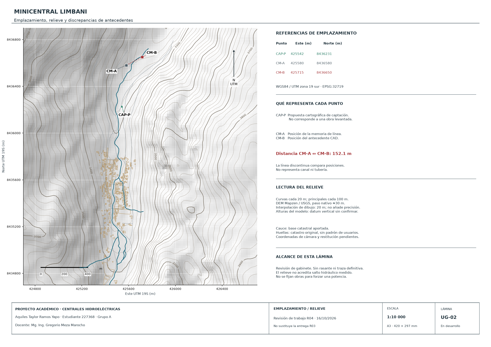

# Avance de mejora · Centrales Hidroeléctricas

16/10/2026. **Lámina de revisión geográfica y contraste de turbina; no es todavía una nueva entrega integral.** La memoria, los planos y la exposición R03 se conservan.

- [Abrir lámina geográfica A3 en PDF](Limbani_R04_UG-02_emplazamiento_revision.pdf).
- [DXF editable en coordenadas UTM](Limbani_R04_UG-02_emplazamiento_revision.dxf), con modelo en metros y presentación A3.
- [Google Earth KMZ](Limbani_R04_UG-02_emplazamiento_revision.kmz): referencias, cauce y carpetas opcionales de curvas y huellas.
- [SVG vectorial](Limbani_R04_UG-02_emplazamiento_revision.svg).
- [Puntos de referencia para QGIS](referencias_emplazamiento_UTM19S.geojson): EPSG:32719 declarado en el archivo. Para intercambio GeoJSON estricto, reproyectar a EPSG:4326.
- [Verificación de geometría y procedencia](verificacion-ug02.json).
- [Diagnóstico y alcance de la siguiente revisión](../../documentacion/MEJORA_PROPUESTA_R04.md).
- [Cálculos del contraste T12](../../datos/turbina/contraste-t12-r04.json).

El plano sitúa la captación propuesta y ambas casas de máquinas candidatas, separadas aproximadamente 152 m. No define la posición de cámara de carga, la restitución ni una traza hidráulica final. El relieve procede de DEM público de unos 30 m; las curvas cada 20 m no representan precisión altimétrica de 20 m ni levantamiento de campo. La escala 1:10000 corresponde a imprimir el PDF al 100% en A3.

En Google Earth, activar las carpetas de curvas o catastro cuando se necesiten. Las geometrías se apoyan sobre el terreno del visor; la cota indicada de cada curva sigue siendo del DEM de origen, cuyo datum vertical no se verificó.

La base catastral contiene tres geometrías inválidas. Se reparó únicamente su representación temporal para recortar el dibujo; el GeoPackage original no se modificó. PDF y DXF comparten puntos y contornos calculados. El DXF se reabrió sin errores de auditoría y el retorno de coordenadas KMZ a UTM se comprobó con error menor de 1 mm; esa precisión de transformación no acredita precisión del emplazamiento.

