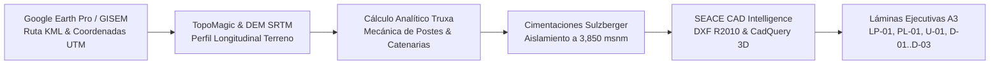

# Proyecto: Línea Primaria y Subestación de Distribución — Capachica

**Curso:** Instalaciones Eléctricas II (MEC330)  
**Semestre Académico:** 2026-II | IX Ciclo  
**Facultad:** FIME — Escuela Profesional de Ingeniería Mecánica Eléctrica | UNA Puno  
**Docentes:** Ing. Leonidas Vilca Callata / Ing. Marcos José Villanueva Cornejo  
**Estudiante:** Renzo Gabriel Mamani Galindo (Cód. 228447)  

---

## 1. Resumen Ejecutivo del Proyecto

Diseño definitivo de una **Línea Primaria de Distribución en Media Tensión (22.9 kV)** y una **Subestación de Distribución Proyectada (SED)** para la electrificación de una localidad rural adyacente al sector **Chifrón, Distrito de Capachica, Puno**.

El punto de diseño y derivación está validado en la infraestructura oficial de **Electro Puno S.A.A.** extraída del geovisor **GISEM de OSINERGMIN**:
- **Tramo MT existente:** `TMT000012389` / `TMT001847370`
- **Punto de Conexión / Derivación (E-01):** Estructura en cresta del Cerro Chifrón (red existente Electro Puno).
  - Coordenadas UTM WGS-84 Zona 19S:
    - Este (X): `412,606.01 m E`
    - Norte (Y): `8,270,712.24 m N`
    - Cota: `3,924.17 msnm` (Progresiva `0+000.00 m`)
    - Latitud: `-15.640067° S`, Longitud: `-69.815400° W`
- **Subestación de Distribución Biposte Proyectada (SED E-04):**
  - Coordenadas UTM WGS-84 Zona 19S:
    - Este (X): `412,759.20 m E`
    - Norte (Y): `8,270,976.22 m N`
    - Cota: `3,839.56 msnm` (Progresiva `0+305.21 m`)
    - Potencia: `100 kVA`, $22.9 / 0.38 - 0.22\text{ kV}$, Grupo Dyn5
  - Altitud de diseño del proyecto: `3,817.04` a `3,924.17 msnm` (Media: `3,850 msnm`)

---

---

## 2. Flujo de Ingeniería y Automatización

1. **Topografía y Traza Georreferenciada (`fuentes/`, `datos/`):** Traza de $816.60\text{ m}$ desde cresta Cerro Chifrón ($0+000\text{ m}$, $3,924.17\text{ msnm}$) hasta playa Chifrón ($0+816.60\text{ m}$, $3,824.61\text{ msnm}$) por accesos vecinales.
2. **Cálculos Analíticos Rigurosos (`scripts/`, `calculo-mecanico/`, `diseno-electrico/`):**
   - Ecuación de cambio de estado de Truxa para conductor AAAC $35\text{ mm}^2$ bajo 5 hipótesis CNE Suministro 2011.
   - Esfuerzos mecánicos en postes C.A.C. 12/300, 12/400 y biposte 13/400 con $FS \ge 2.0$.
   - Cimentaciones por Método de Sulzberger ($FS_{\text{Sulz}} \ge 1.50$) y bloques de retenida ($FS_{\text{arr}} \ge 2.0$).
   - Coordinación de aislamiento a $3,850\text{ msnm}$ ($K_a = 1.25$ CNE / $1.42$ IEC, BIL $170\text{ kV}$, fuga $810\text{ mm}$).
   - Caída de tensión en MT ($0.046\%$) y pérdidas ($46.2\text{ W}$).
3. **Pliegos Técnicos SEACE (`expediente/`):** Especificaciones técnicas de suministro y montaje alineadas a Electro Puno LP-SM-15-2024-ELECTROPUNO y análisis de precios unitarios (APU).
4. **Planos Ejecutivos Formales A3 (`entregables/planos/`):**
   - **LP-01:** Plano de Traza, Planta General y Servidumbre de Línea Primaria 22.9 kV (Escala 1:2000).
   - **PL-01:** Perfil Longitudinal Topográfico, Spotting y Catenarias (H: 1:2000, V: 1:500).
   - **U-01:** Diagrama Unifilar General y Protecciones de Media Tensión 22.9 kV.
   - **D-01:** Detalles de Armados Normalizados DGE PS-1 (Suspensión) y PA-1 (Ángulo) 22.9 kV.
   - **D-02:** Detalles de Armado DGE PR-1 y Subestación Aérea Biposte SAB-1 100 kVA.
   - **D-03:** Detalles de Cimentación Sulzberger, Retenidas Mecánicas R-1 y Puesta a Tierra PAT-3.
   - **Modelos SEACE:** Planos DXF y modelos 3D CadQuery en `entregables/planos/cad_linea_primaria/`.

---

## 3. Estructura de Directorios

- `datos/`: Parámetros canónicos del proyecto, tablas de conductores y catálogo de postes C.A.C.
- `fuentes/`: KML de Google Earth, datos y evidencias georreferenciadas de GISEM OSINERGMIN.
- `diseno-electrico/`: Memoria de cálculo eléctrico en media tensión 22.9 kV y cuadros de carga.
- `calculo-mecanico/`: Memoria completa de cálculo mecánico de conductores, postes, retenidas y cimentaciones.
- `expediente/`: Memoria descriptiva, especificaciones técnicas SEACE, APUs, metrados y cronograma de obra.
- `entregables/planos/`: Las 6 láminas oficiales ejecutivas en PDF A3, DXF R2010 y renders PNG.
- `scripts/`: Suite de automatización en Python (cálculos, cimentaciones, aislamiento y generador de planos).
- `tests/`: 16 pruebas unitarias con pytest (cálculos mecánicos, eléctricos, cimentaciones y auditoría de planos).

