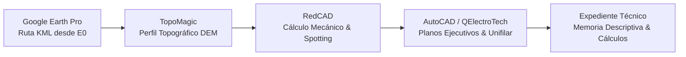

# Proyecto: Línea Primaria y Subestación de Distribución — Capachica

**Curso:** Instalaciones Eléctricas II (MEC330)  
**Semestre Académico:** 2026-II | IX Ciclo  
**Facultad:** FIME — Escuela Profesional de Ingeniería Mecánica Eléctrica | UNA Puno  
**Docentes:** Ing. Leonidas Vilca Callata / Ing. Marcos José Villanueva Cornejo  
**Estudiante:** Renzo Gabriel Mamani Galindo (Cód. 228447)  

---

## 1. Resumen Ejecutivo del Proyecto

Diseño definitivo de una **Línea Primaria de Distribución en Media Tensión (22.9 kV)** y una **Subestación de Distribución Proyectada (SED)** para la electrificación de una localidad rural adyacente al sector **Chifrón, Distrito de Capachica, Puno**.

El punto de diseño y derivación está validado en la infraestructura oficial de **Electro Puno S.A.A.** extraída del geovisor **GISEM de OSINERGMIN**:
- **Tramo MT existente:** `TMT000012389` / `TMT001847370`
- **Punto de Conexión:** Estructura $E_0$ en Centro de Transformación (`CT`) existente en Chifrón.
- **Coordenadas WGS84:**
  - Latitud: `-15.640067°`
  - Longitud: `-69.815400°`
- **Coordenadas UTM Zona 19S:**
  - Este (X): `412,602.07 m`
  - Norte (Y): `8,270,710.08 m`
  - Altitud media: `3,820 msnm`

---

## 2. Flujo de Ingeniería y Automatización

1. **Google Earth Pro (`fuentes/kml/`):** Trazado de ruta siguiendo accesos rurales, minimizando ángulos y evitando zonas bajas/inundables del Lago Titicaca.
2. **TopoMagic (`datos/topografia/`):** Extracción de perfil longitudinal del terreno con cotas y progresivas.
3. **RedCAD (`diseno-electrico/` y `calculo-mecanico/`):**
   - Distribución de postes de Concreto Armado Centrifugado (C.A.C. 12/300 y 12/400).
   - Cálculo de vano peso, vano eólico y catenarias bajo 5 hipótesis climáticas del CNE Suministro para Puno (>3800 msnm).
   - Cálculo de caída de tensión ($\Delta V\% < 5.0\%$) y pérdidas en MT.
4. **Expediente Técnico (`expediente/`):**
   - Memoria Descriptiva.
   - Especificaciones Técnicas de Suministro y Montaje.
   - Memoria de Cálculos Eléctricos y Mecánicos.
   - Metrados y Presupuesto referencial.
   - Planos ejecutivos en `entregables/planos/`.

---

## 3. Estructura de Directorios

- `fuentes/`: Archivo KML original de Google Earth, datos de GISEM y archivos `.top` de TopoMagic.
- `datos/`: Parámetros canónicos del proyecto, tablas de conductores y catálogo de postes.
- `documentacion/`: Supuestos normativos (CNE Suministro 2011, Norma DGE ER) y registro de decisiones.
- `diseno-electrico/`: Memorias y scripts de caída de tensión y pérdidas.
- `calculo-mecanico/`: Hojas y scripts de catenaria y ecuación de cambio de estado.
- `expediente/`: Fuentes Markdown / LaTeX para el informe final.
- `entregables/`: PDF final del expediente y planos DWG listos para entrega.
- `scripts/`: Herramientas en Python para automatizar el cálculo de ingeniería.
